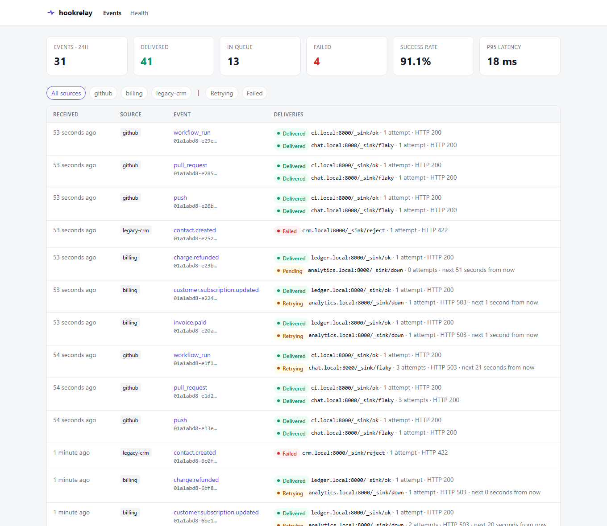
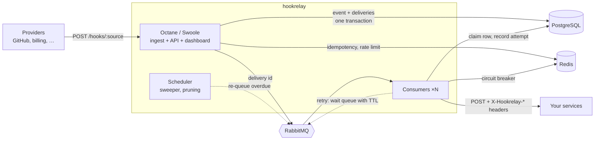
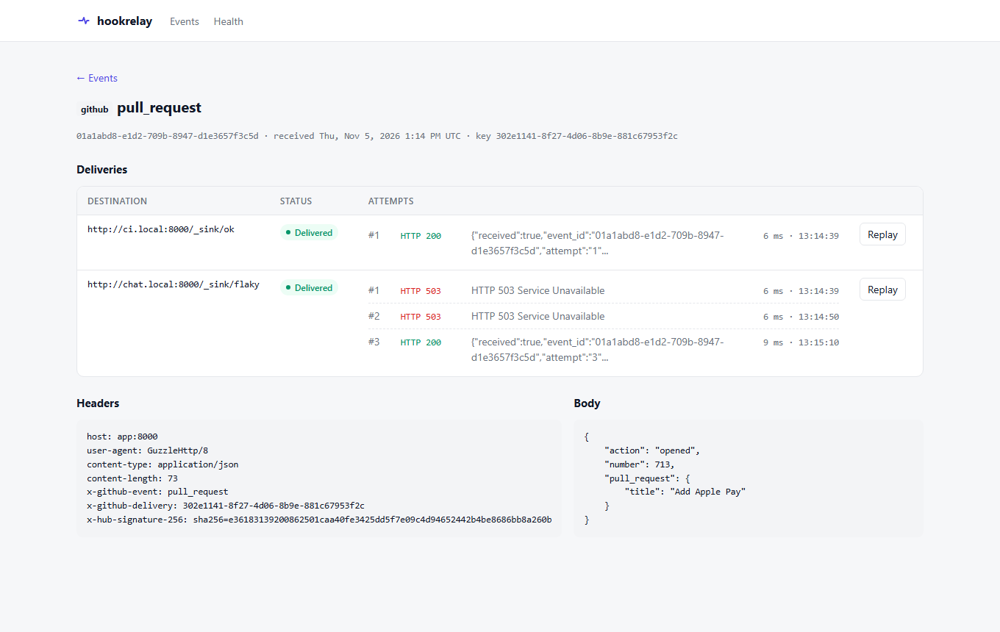

# hookrelay

[](https://github.com/berkheev/hookrelay/actions/workflows/ci.yml)


**A self-hosted webhook relay: receive, verify, store and reliably forward webhooks, with retries, replay and a delivery log.**

Put hookrelay between webhook providers (GitHub, payment providers, SaaS tools, your own services) and the internal services that consume their events. It accepts every webhook in a few milliseconds, persists it, and takes care of getting it delivered, even when the consumer is down, slow or being deployed.



## The problem

Webhooks look simple: someone sends an HTTP POST, you handle it. In production, things go wrong:

| Problem | What happens without a relay |
|---|---|
| The consumer is down during a deploy | The provider retries a few times on *its* schedule, then gives up. The event is lost. |
| The consumer is slow | The provider times out (often after 5–10 s) and marks the delivery as failed, or sends it again. |
| Duplicates | Providers deliver *at least once*. The same `invoice.paid` arrives twice, and a customer gets two emails. |
| No visibility | "Did we get the webhook?" means grepping logs on several servers. There is no way to resend one. |
| Fan-out | Three services need the same GitHub event. The provider allows one URL, or each service needs its own config. |
| Security | Every consumer has to implement signature verification, and some forget. |

hookrelay solves these in one place:

- **Fast acknowledgement**: the webhook is stored in PostgreSQL and acknowledged with `202` right away; delivery happens asynchronously.
- **Reliable delivery**: a RabbitMQ-based queue with exponential backoff + jitter, a per-destination circuit breaker and a sweeper that recovers anything lost. Delivery is at-least-once.
- **Deduplication**: by the provider's delivery id (`X-GitHub-Delivery`, `Idempotency-Key`, …), fast in Redis and guaranteed by a unique index in Postgres.
- **Signature verification** (HMAC-SHA256) at the edge, and optional re-signing of forwarded payloads with a secret per source.
- **Fan-out** to any number of destinations per source.
- **Dashboard and REST API**: every event, every attempt with status code, latency and response, and one-click **replay**.

## Architecture



**Ingest** (`POST /hooks/{source}`, Laravel Octane on Swoole): looks up the source, checks the payload size, verifies the signature, applies a per-source rate limit (Redis) and deduplicates by idempotency key. It then stores the event and one delivery row per destination **in a single transaction**, and publishes the delivery ids to RabbitMQ. Swoole keeps the framework booted between requests, so this path takes single-digit milliseconds.

**Delivery** (`php artisan hookrelay:consume`, run as many replicas as you like): consumers take a delivery id from the queue, **atomically claim** the row (so the same delivery is never sent twice in parallel), POST the original body and headers to the destination and record the attempt. The outcome:

- `2xx`: delivered.
- `5xx`, `408`, `429`, network error or timeout: retried after `10s · 2^(n-1)` ± 20% jitter, capped at 1 h. After 8 attempts (≈ 21 min with the defaults) the delivery is marked failed.
- other `4xx`: failed immediately. The destination rejected the payload, and sending it again won't help.

**Delayed retries in RabbitMQ.** RabbitMQ has no built-in delayed messages, and a single queue with per-message TTLs doesn't work, because messages expire only at the head of the queue. So there is a set of *wait queues* with fixed TTLs (1s, 2s, 5s … 45m, 1h) that dead-letter back into the work queue. A retry goes to the smallest bucket that is at least the requested delay (never more than 1.5× of it), and that effective delay is what gets stored as `next_attempt_at`.

**Circuit breaker.** If a destination host fails 5 times in a row, it is considered down for 60 s. Its deliveries are postponed without spending their retry budget, so they don't hammer a service that is trying to come back up. The state lives in Redis and is shared by all consumers.

**Sweeper.** Every minute the scheduler re-publishes pending deliveries that are overdue and unclaimed, for example when RabbitMQ was unreachable at ingest time or a consumer was killed mid-attempt. Because the database is the source of truth and consumers re-check the row, duplicate messages are harmless.

### What each piece of the stack does

| Component | Role |
|---|---|
| **Laravel 13 + Octane (Swoole)** | HTTP server: ingest, REST API, dashboard. Long-running workers, no per-request bootstrap. |
| **PostgreSQL 16** | Source of truth: events (`jsonb` headers), deliveries, attempt log. Atomic row claiming, `percentile_cont` for latency stats. |
| **RabbitMQ 3.13** | Work queue (quorum queue) + TTL/dead-letter wait queues for delayed retries. |
| **Redis 7** | Idempotency fast path, per-source rate limiting, circuit breaker state, dashboard stats cache, sessions. |
| **Docker Compose** | Everything above plus consumers and scheduler. Nothing to install on the host except Docker. |

## Quick start

Requires only Docker.

```bash
git clone https://github.com/berkheev/hookrelay.git
cd hookrelay

cp .env.example .env
cp sources.example.json sources.json

docker compose build
docker compose run --rm --no-deps app composer install
docker compose run --rm --no-deps app php artisan key:generate
docker compose run --rm app php artisan migrate
docker compose up -d
```

(Or just `make setup` if you have `make`.)

| URL | What |
|---|---|
| http://localhost:8000 | Dashboard |
| http://localhost:8000/health | Health check (Postgres, Redis, RabbitMQ) |
| http://localhost:15672 | RabbitMQ management UI (`hookrelay` / `secret`) |

Send some sample traffic. The example config forwards to built-in fake destinations (`/_sink/ok`, `/_sink/flaky`, `/_sink/down`, `/_sink/reject`), each on its own host alias (`ci.local`, `chat.local`, …), so you can watch successes, retries, the circuit breaker and failures:

```bash
docker compose exec app php artisan hookrelay:demo
```

## Configuring sources

Sources live in `sources.json` (path set by `HOOKRELAY_SOURCES_FILE`):

```json
{
    "github": {
        "secret": "the webhook secret you set in GitHub",
        "signature_header": "X-Hub-Signature-256",
        "idempotency_header": "X-GitHub-Delivery",
        "destinations": [
            "https://ci.internal/hooks/github",
            "https://chatops.internal/github"
        ]
    },
    "billing": {
        "secret": "provider signing secret",
        "idempotency_header": "Idempotency-Key",
        "forward_secret": "secret your services use to verify hookrelay",
        "destinations": ["https://ledger.internal/webhooks"]
    }
}
```

| Key | Required | Meaning |
|---|---|---|
| `destinations` | yes | One or more http(s) URLs. Each gets its own delivery with its own retries. |
| `secret` | no | HMAC-SHA256 secret. If set, unsigned or wrongly signed requests get `401`. |
| `signature_header` | no | Header carrying `sha256=<hex>`. Default `X-Signature-256`. |
| `idempotency_header` | no | Header with the provider's unique delivery id, used for deduplication. |
| `forward_secret` | no | If set, forwarded requests carry `X-Hookrelay-Signature: sha256=…` made with this secret. |

Point the provider at `https://your-relay/hooks/<source>`.

### What destinations receive

The original body, byte for byte, with its `Content-Type`, all provider `X-*` headers (e.g. `X-GitHub-Event`) except the provider's signature, plus:

```
X-Hookrelay-Event-Id: 0193f6c2-7a8e-7c41-9a59-3c1f0e6b2d11
X-Hookrelay-Source: github
X-Hookrelay-Attempt: 3
X-Hookrelay-Signature: sha256=…        # when forward_secret is set
```

Delivery is at-least-once, so consumers should treat `X-Hookrelay-Event-Id` as an idempotency key.

## API

All management endpoints use HTTP Basic auth when `HOOKRELAY_ADMIN_PASSWORD` is set.

| Method | Endpoint | Description |
|---|---|---|
| `POST` | `/hooks/{source}` | Ingest a webhook. `202` accepted, `200` duplicate, `401` bad signature, `404` unknown source, `413` too large, `429` rate limited. |
| `GET` | `/api/events?source=&status=&type=&per_page=` | Events with deliveries, newest first, cursor-paginated. |
| `GET` | `/api/events/{id}` | One event with headers, body and the full attempt log. |
| `POST` | `/api/deliveries/{id}/replay` | Send a delivery again with a fresh retry budget. `409` if it is being sent right now. |
| `GET` | `/health` | `200` if Postgres, Redis and RabbitMQ are reachable, otherwise `503`. |

```bash
curl -s localhost:8000/api/events?status=failed | jq '.data[] | {id, source, type}'
```



## Configuration

Everything is set through environment variables, see [`.env.example`](.env.example) and [`config/hookrelay.php`](config/hookrelay.php).

| Variable | Default | |
|---|---|---|
| `HOOKRELAY_MAX_ATTEMPTS` | `8` | Attempts before a delivery is marked failed |
| `HOOKRELAY_BASE_DELAY` / `HOOKRELAY_MAX_DELAY` | `10` / `3600` | Backoff base and cap, seconds |
| `HOOKRELAY_HTTP_TIMEOUT` | `10` | Destination request timeout, seconds |
| `HOOKRELAY_CB_THRESHOLD` / `HOOKRELAY_CB_COOLDOWN` | `5` / `60` | Circuit breaker |
| `HOOKRELAY_RATE_LIMIT` | `600` | Ingest requests per source per minute |
| `HOOKRELAY_MAX_BODY_BYTES` | `1048576` | Max payload size |
| `HOOKRELAY_RETENTION_DAYS` | `14` | Events older than this are pruned nightly |

## Development

```bash
docker compose up -d postgres redis rabbitmq
docker compose run --rm app php artisan test          # PHPUnit, against a real Postgres
docker compose run --rm --no-deps app vendor/bin/phpstan analyse
```

Tests use a separate `hookrelay_test` database (created by `docker/postgres/init.sql`), an in-memory fake instead of RabbitMQ, and Laravel's HTTP fake for destinations.

### Production image

```bash
docker build -f docker/php/Dockerfile --target prod -t hookrelay .
```

Run the same image three ways: `octane:start` (default command), `php artisan hookrelay:consume` and `php artisan schedule:work`. Consumers handle `SIGTERM` gracefully: they finish the delivery in hand and exit.

## Design notes and trade-offs

- **The database is the source of truth, the queue only carries ids.** Losing or duplicating a message never loses or duplicates a webhook; the sweeper and row claiming take care of it.
- **Publish after commit, not inside the transaction.** A webhook is never acknowledged without being stored. If the broker is down the provider still gets `202`, and the sweeper delivers it later. The price is up to a minute of extra latency in that rare case.
- **No ordering guarantees.** Retries make strict ordering impossible without head-of-line blocking. Consumers should rely on timestamps or versions in the payload.
- **Payloads are kept in Postgres as text.** Fine for typical JSON/form webhooks up to the 1 MiB default; binary payloads would need `bytea` or object storage.

## License

MIT, see [LICENSE](LICENSE).
